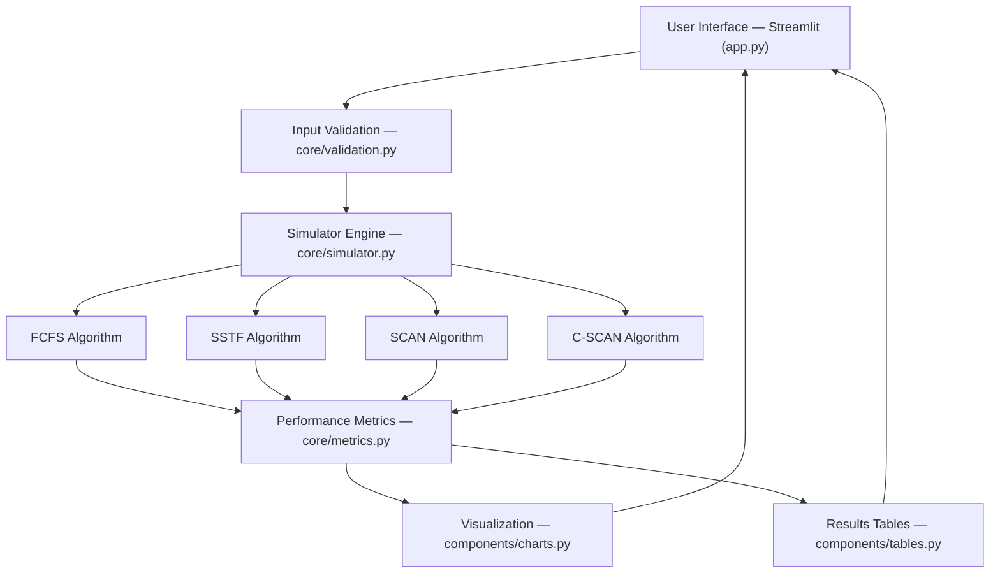
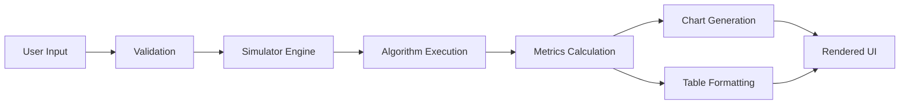
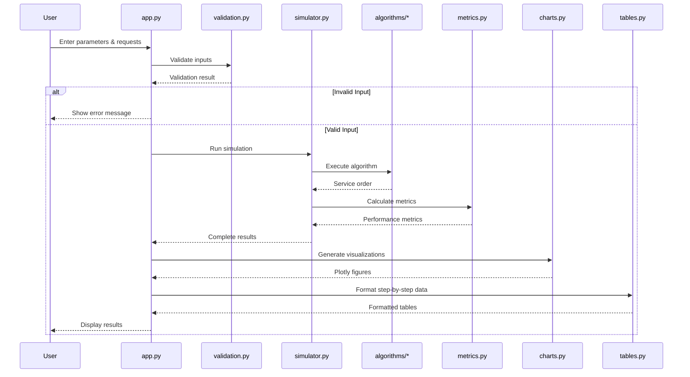
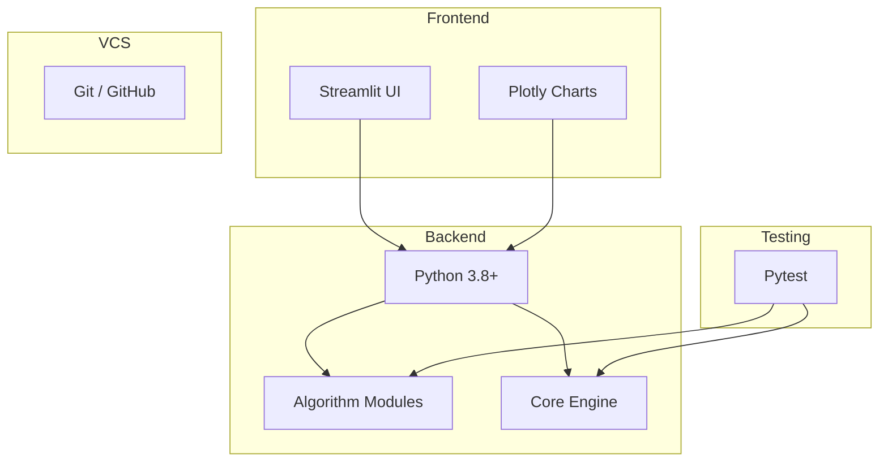

# System Architecture

**Advanced Disk Scheduling Simulator — Architecture Documentation**

---

## 1. System Architecture Overview

The Advanced Disk Scheduling Simulator follows a **modular layered architecture** that separates concerns into distinct layers: presentation, orchestration, computation, and testing. This design promotes code reusability, testability, and maintainability.

### High-Level Architecture Diagram



---

## 2. Architectural Layers

### Layer 1: Presentation Layer (`app.py` + `components/`)

The presentation layer handles all user interaction through the Streamlit web framework. It is responsible for:

- Rendering the sidebar input form (disk size, head position, direction, seek time, request sequence)
- Displaying algorithm selection options (single algorithm or compare all)
- Rendering charts (via `components/charts.py`) and tables (via `components/tables.py`)
- Showing error messages for invalid inputs

### Layer 2: Orchestration Layer (`core/simulator.py`)

The simulator engine acts as the central coordinator:

- Receives validated input parameters
- Dispatches execution to the appropriate algorithm module(s)
- Collects the service order (traversal sequence) from each algorithm
- Passes the service order to the metrics calculator
- Returns a structured result object containing the service order, metrics, and metadata

### Layer 3: Computation Layer (`algorithms/` + `core/metrics.py`)

This layer contains the pure computational logic:

- **`algorithms/`** — Each module implements a single disk scheduling algorithm as a pure function. Given a request queue and parameters, it returns the ordered service sequence.
- **`core/metrics.py`** — Computes performance metrics (total head movement, average head movement, total seek time, average seek time, throughput) from the service order.

### Layer 4: Validation Layer (`core/validation.py`)

Input validation is isolated into its own module to enforce:

- Disk size must be a positive integer
- Head position must be within `[0, disk_size - 1]`
- All requests must be within `[0, disk_size - 1]`
- Request sequence must not be empty (or handled gracefully)
- Seek time per cylinder must be a positive number

---

## 3. Module Descriptions

### 3.1 `algorithms/` — Algorithm Implementations

| Module | Algorithm | Description |
|---|---|---|
| `fcfs.py` | FCFS | Processes requests in arrival order |
| `sstf.py` | SSTF | Selects the closest pending request at each step |
| `scan.py` | SCAN | Moves in one direction to boundary, then reverses |
| `cscan.py` | C-SCAN | Moves in one direction, wraps to opposite boundary |

Each module exports a single function with a consistent signature:

```python
def algorithm_name(requests: list[int], head: int, **kwargs) -> list[int]:
    """Returns the ordered service sequence."""
```

### 3.2 `core/` — Core Application Logic

| Module | Responsibility |
|---|---|
| `simulator.py` | Orchestrates algorithm execution and result assembly |
| `metrics.py` | Computes all performance metrics from a service order |
| `validation.py` | Validates and sanitizes all user inputs |

### 3.3 `components/` — UI Components

| Module | Responsibility |
|---|---|
| `charts.py` | Generates Plotly figures for head movement and comparison |
| `tables.py` | Formats step-by-step simulation data into display tables |

---

## 4. Data Flow

The data flows through the system in a linear pipeline:



### Data Flow Description

1. **User Input** — The user enters disk parameters and a request sequence through the Streamlit sidebar.
2. **Validation** — `core/validation.py` validates all inputs. Invalid inputs trigger error messages without proceeding further.
3. **Simulator Engine** — `core/simulator.py` receives validated inputs and invokes the selected algorithm(s).
4. **Algorithm Execution** — The chosen algorithm module processes the request queue and returns the service order (an ordered list of cylinder numbers visited).
5. **Metrics Calculation** — `core/metrics.py` takes the service order and computes total head movement, average head movement, total seek time, average seek time, and throughput.
6. **Chart Generation** — `components/charts.py` creates Plotly figures (head movement line chart, comparison bar chart).
7. **Table Formatting** — `components/tables.py` formats step-by-step data showing each movement with distance.
8. **Rendered UI** — Streamlit displays all results, charts, and tables to the user.

---

## 5. Component Interaction Diagram



---

## 6. Design Decisions

### 6.1 Why Streamlit?

| Consideration | Rationale |
|---|---|
| **Rapid prototyping** | Streamlit allows building interactive web apps with pure Python — no HTML/CSS/JS required |
| **Built-in widgets** | Native support for sliders, number inputs, select boxes, and text inputs |
| **Data display** | Built-in support for DataFrames, tables, and chart rendering |
| **Academic focus** | Lets students focus on algorithm logic rather than web development |
| **Deployment** | Easy deployment via Streamlit Community Cloud |

### 6.2 Why Plotly?

| Consideration | Rationale |
|---|---|
| **Interactivity** | Plotly charts support zoom, pan, hover tooltips, and click interactions |
| **Streamlit integration** | Native `st.plotly_chart()` support in Streamlit |
| **Publication quality** | Produces professional-quality charts suitable for reports |
| **Customization** | Highly customizable colors, labels, axes, and layouts |

### 6.3 Why Modular Architecture?

| Consideration | Rationale |
|---|---|
| **Separation of concerns** | Each module has a single responsibility |
| **Testability** | Algorithm logic can be tested independently of the UI |
| **Extensibility** | New algorithms can be added without modifying existing code |
| **Readability** | Smaller, focused modules are easier to understand and review |
| **Reusability** | Algorithm and metrics modules can be reused in other projects |

### 6.4 Why Pure Functions for Algorithms?

Each algorithm is implemented as a pure function (no side effects, no global state):

- **Deterministic** — Same inputs always produce same outputs
- **Testable** — Easy to write unit tests without mocking
- **Composable** — Can be called from the simulator engine or directly from tests
- **Thread-safe** — No shared mutable state

---

## 7. Error Handling Strategy

The application employs a defensive error handling strategy:

1. **Validation at the boundary** — All user inputs are validated before entering the computation pipeline.
2. **Graceful degradation** — Edge cases (empty queue, single request) produce valid results rather than errors.
3. **Descriptive error messages** — Validation failures produce clear, user-friendly messages explaining what went wrong and how to fix it.
4. **No silent failures** — All error conditions are either handled or explicitly surfaced to the user.

---

## 8. Technology Stack Summary



