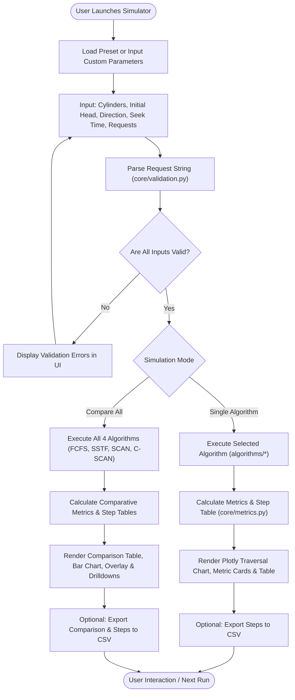
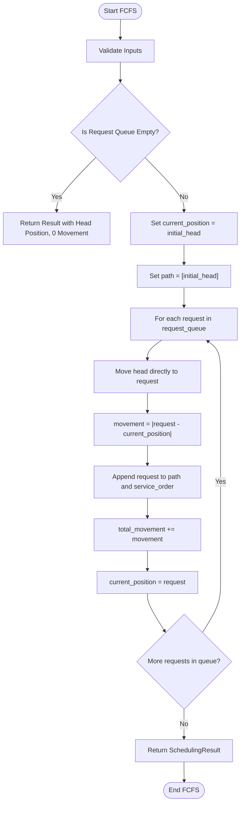
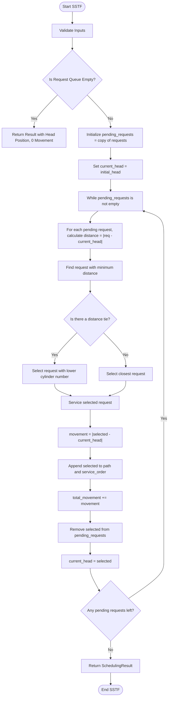
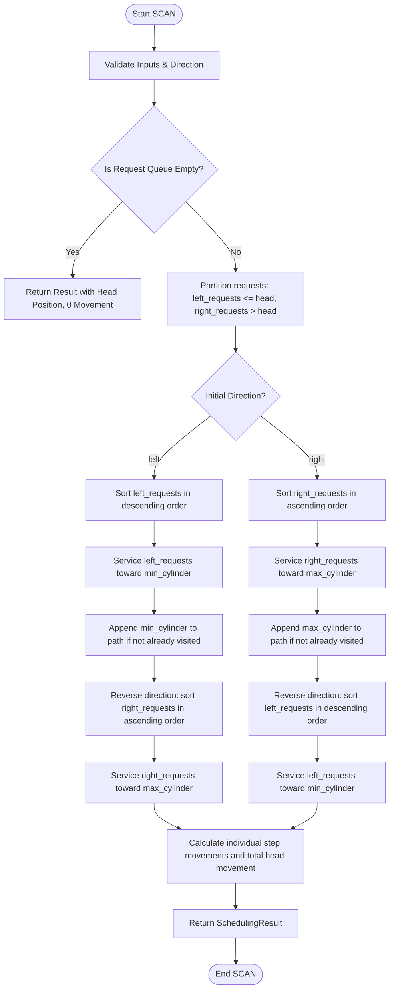
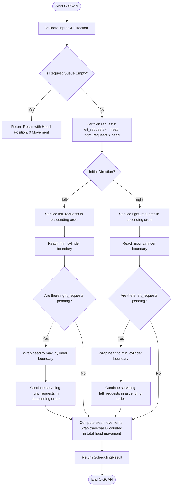

# System and Algorithm Flowcharts

**CSE316 — Operating Systems | Continuous Assessment 3**  
*Advanced Disk Scheduling Simulator*

---

## 1. System Execution Flowchart

The overall system processes user input through a pipeline of validation, simulation, metrics calculation, and interactive rendering:

---

## 2. FCFS (First Come, First Served) Flowchart

FCFS processes requests strictly in the order they arrive in the queue.

---

## 3. SSTF (Shortest Seek Time First) Flowchart

SSTF selects the pending request that requires the minimum head movement from the current head position. Ties are broken by choosing the lower cylinder number.

---

## 4. SCAN (Elevator Algorithm) Flowchart

SCAN moves the head in the designated direction servicing requests until it hits the boundary, then reverses direction.

---

## 5. C-SCAN (Circular SCAN) Flowchart

C-SCAN services requests in one direction only. When it reaches the boundary, it wraps directly to the opposite boundary and resumes servicing in the original direction.

